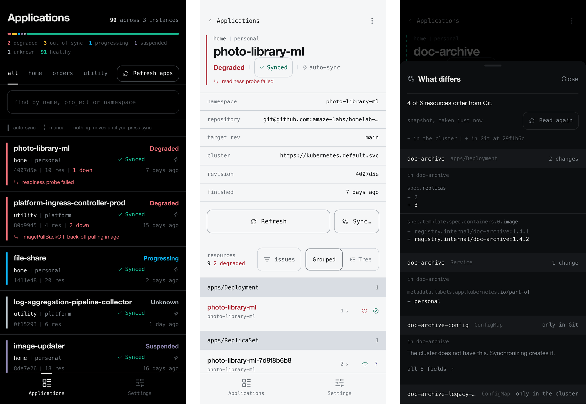
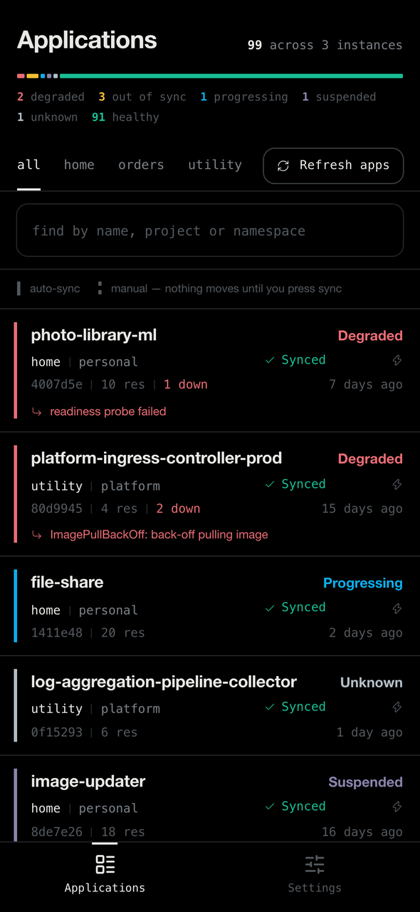
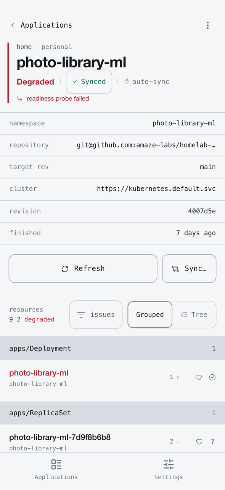
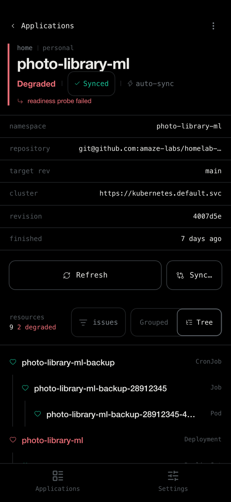
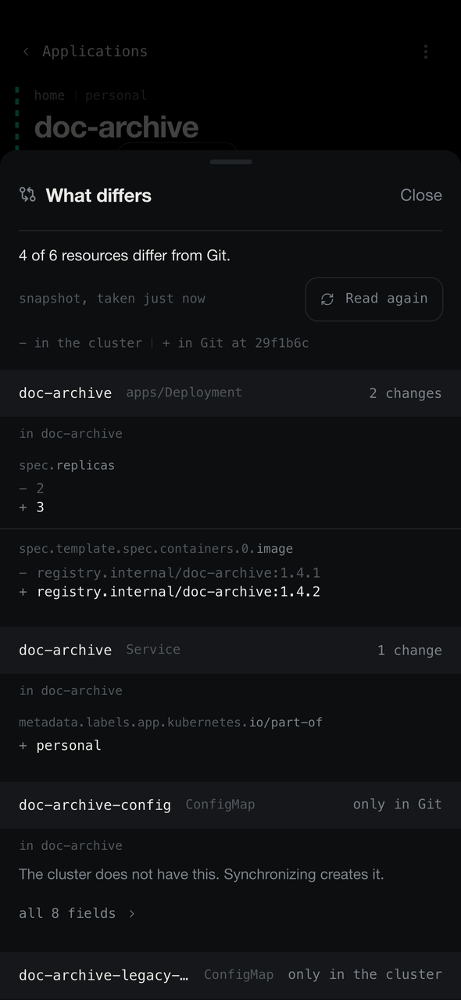
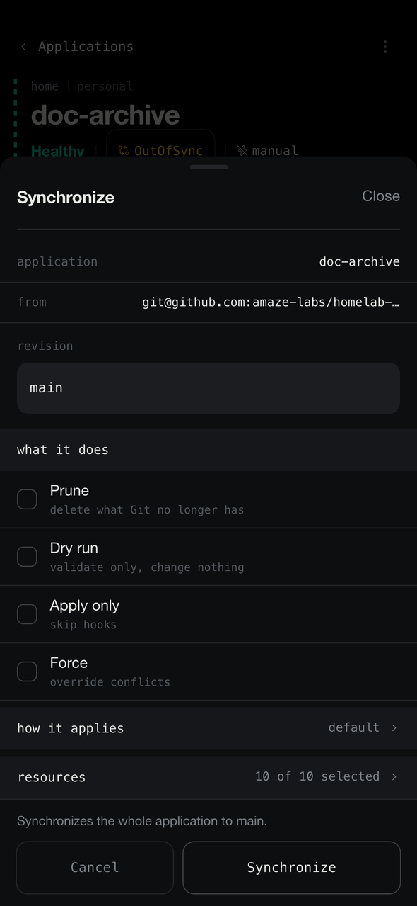
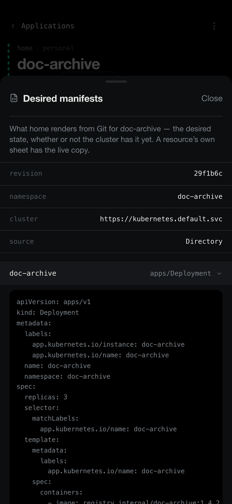

# MazeCD

A self-hosted **mobile-first PWA for watching several ArgoCD instances from one
screen**: one aggregated application list, the resource tree, pod logs, what
differs from Git, the manifests Git asks for — and a login you only do once.



## What it does

- **Every instance in one list** — the applications of all your ArgoCD
  instances together, with health and sync at a glance, filters by instance
  and a search over name, project and namespace.
- **Live, not polled** — state arrives on ArgoCD's own watch streams, one per
  instance, closed while the app is in the background; a 30-second poll is
  only the fallback for an instance whose stream cannot be held open.
- **An application, whole** — its source and revision, the resources grouped
  by kind or as a tree, each one's live manifest and, for a pod, its logs.
- **What differs from Git** — a field-level diff of every resource that is out
  of sync, and the desired manifests Git renders, before anything is applied.
- **It can act, if the token lets it** — synchronize an application (prune,
  dry run, a chosen revision, a subset of resources) and run a resource's own
  ArgoCD actions, such as restarting a Deployment. Give the token `get` alone
  and MazeCD is a read-only instrument.
- **Light footprint** — one Go binary in one container, serving the API and
  the embedded PWA; the ArgoCD tokens stay on the server and never reach the
  phone.

| | |
| --- | --- |
|  |  |
| **Applications** from every instance, worst first | **An application**: source, revision and resources |
|  |  |
| **The resource tree**, as ArgoCD owns it | **What differs** between the cluster and Git |
|  |  |
| **Synchronize** with prune, dry run and a revision | **Desired manifests**, as YAML |

## Quick start

You need Docker with the Compose plugin and an ArgoCD API token for each
instance — [ArgoCD access](docs/argocd-access.md) shows how to create one,
read-only or not. Save this as `docker-compose.yml`:

```yaml
services:
  mazecd:
    image: ghcr.io/amaze-labs/mazecd:latest
    restart: unless-stopped
    ports:
      - "127.0.0.1:8080:8080"
    env_file: .env
    volumes:
      - ./config.yaml:/etc/mazecd/config.yaml:ro
```

and this as `config.yaml`, one entry per instance:

```yaml
instances:
  - name: prod
    url: https://argocd.example.com
    token: ${ARGOCD_TOKEN_PROD}
```

Choose a password and get its hash — `hash` asks for it on the terminal and
prints the bcrypt hash — then generate a session key:

```bash
docker run --rm -it ghcr.io/amaze-labs/mazecd:latest hash
openssl rand -base64 32
```

Put both in `.env`, with the ArgoCD token. Keep the hash in single quotes: it
contains `$`, which Compose would otherwise read as a variable.

```bash
MAZECD_PASSWORD_HASH='$2a$10$...'
MAZECD_SESSION_KEY=...
ARGOCD_TOKEN_PROD=...
```

Then start it:

```bash
docker compose up -d
```

Open <http://localhost:8080> and sign in with that password. Anywhere other
than `localhost` MazeCD has to be served over HTTPS: see
[Installation](docs/installation.md).

## Documentation

| | |
| --- | --- |
| [Installation](docs/installation.md) | Docker, Kubernetes, HTTPS and reverse proxies, upgrades, health check |
| [Configuration](docs/configuration.md) | The instances file and every environment variable, with its default |
| [ArgoCD access](docs/argocd-access.md) | The account and token per instance, the read-only policy, what each write needs |
| [Development](docs/development.md) | Running from source, tests, the dev harness, releases |

## License

Copyright © 2026 Amaze Labs

MazeCD is free software, licensed under the **GNU Affero General Public License
v3.0 or later**; see [LICENSE](LICENSE).

You can run, modify and self-host it freely. The AGPL's network clause means that
if you offer a modified MazeCD to others over a network, as a hosted or managed
service, you must also offer those users the source of your modified version.
